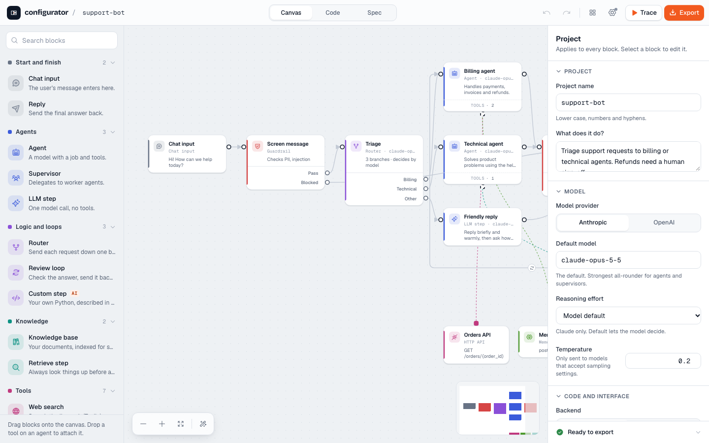
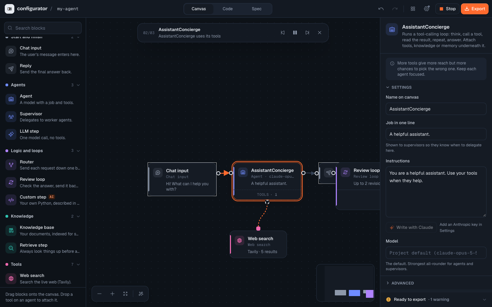
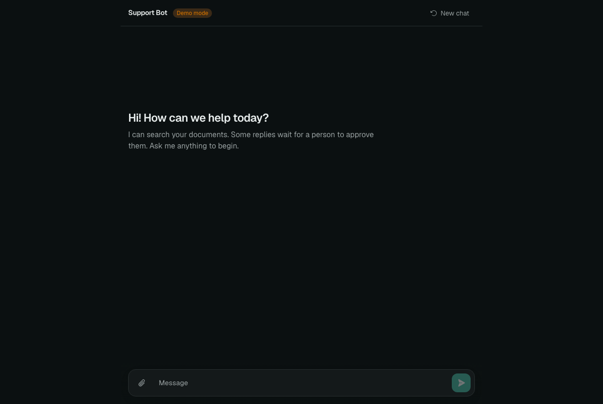
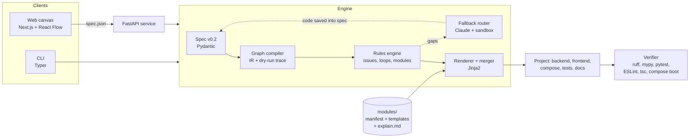

# Agent Configurator

Design an agentic or multi-agent loop on a canvas, press **Export**, and get a complete,
working project: FastAPI + LangGraph backend, Next.js chat UI, Docker Compose, tests and docs.



The code comes from **deterministic templates**, not from an LLM. The same design always
produces the same bytes, every supported combination is tested, and the predictable 95%
of an agent app costs zero tokens. Claude is used only for what templates can't know:
your custom tools, and drafting a graph from a description.

## Run it

Needs Python 3.12+ and Node.js 20+.

```bash
make setup     # engine venv + web dependencies
make dev       # engine API on :8787, canvas on http://localhost:3000
```

Or with Docker: `docker compose up --build`, then open http://localhost:3000.

Optional: set `ANTHROPIC_API_KEY` before `make dev` (or paste a key in **Settings** on the
canvas) to turn on the Claude features. Everything else works without a key.

## A two-minute tour

1. **Start a loop.** Pick a blueprint (support desk, research team, RAG pipeline…) or
   describe your app and let Claude draft the graph.
2. **Shape it.** Drag blocks from the toolkit. Drop a tool on an agent to attach it.
   Wire outputs to inputs; branching blocks label each port (Pass / Revise, Approved /
   Rejected, one port per router branch). Invalid wires are refused as you drag.
3. **Check it.** Problems appear as badges on the blocks and in the inspector. A loop with
   no way out is blocked before it can hang your app.
4. **Trace it.** Press **Trace** (or `T`). A pulse runs along the cables step by step and a
   ticker narrates each decision; review loops visibly go round.
5. **Read the code.** The **Code** view shows the exact export. Select a block to see only
   the files it produces.
6. **Export.** Unzip, then:

   ```bash
   cp .env.example .env            # add ANTHROPIC_API_KEY, or set LLM_PROVIDER=fake
   make setup && make test && make dev
   ```

   `LLM_PROVIDER=fake` runs an offline demo model, so you can click through the whole app,
   approvals included, before spending anything.



## Where an LLM is used (and where it isn't)

| Task | How |
| --- | --- |
| Rendering the project | Jinja2 templates + a rules engine. No LLM. |
| Choosing modules, validating the graph, merging dependency files | Plain Python if/else. No LLM. |
| **Text → spec** ("describe your app") | Claude proposes a graph with structured output. The rules engine checks it and sends errors back; you confirm it on the canvas. No key → the closest blueprint. |
| **Fallback router** (Custom tool / Custom step blocks) | Claude writes the function against a strict contract (name, signature, example, the test it must pass). Code is checked statically, then run against its test in a no-network container when Docker is up. Up to three attempts, then the block stays open and is listed in `PROMPT_PACK.md`. |
| **Prompt help** ("Write with Claude" on an agent) | Drafts the agent's instructions from its role and tools. |

Generated code from Claude is saved **into the spec**, so later exports stay repeatable.

## What you can build

| Category | Blocks |
| --- | --- |
| Start and finish | Chat input, Reply |
| Agents | Agent (tool-calling loop), Supervisor (delegates to workers), LLM step |
| Logic and loops | Router (model or keywords), Review loop (critic with max attempts), Custom step |
| Knowledge | Knowledge base (PDF/Markdown/text/HTML → pgvector or Chroma, dense or hybrid, optional reranker), Retrieve step |
| Tools | Web search, Read web page, HTTP API, MCP server, Calculator, SQL database, Custom tool |
| Memory | Conversation store (in-memory, SQLite, Postgres) and long-term memory |
| Safety and humans | Guardrail (PII redaction, prompt-injection and term blocking), Human approval (interrupt and resume) |

Every export includes a streaming chat UI with a live activity timeline, approval cards,
feedback buttons and document upload; `DECISIONS.md` (why each technology, and its
trade-off); `PROMPT_PACK.md` (paste into Claude Code to extend safely); and extension
points in `backend/app/custom/` that regeneration never overwrites.



## Command line

```bash
configurator templates                          # list blueprints
configurator init --from support-bot            # write spec.json (asks a few questions)
configurator validate spec.json                 # schema + rules
configurator explain spec.json                  # the loop, a dry run, every trade-off
configurator generate spec.json -o ./out        # or -o out.zip; --fill-gaps asks Claude for custom code
configurator verify ./out                       # ruff, mypy, tests, ESLint, tsc (--boot: compose up)
configurator from-text "a bot that triages support tickets"
configurator serve                              # the API the canvas talks to
```

## How it fits together



More in [docs/architecture.md](docs/architecture.md). To add a block or option, see
[docs/extending.md](docs/extending.md). Each technology choice has a short record in
[docs/decisions/](docs/decisions/).

## Repository layout

```
packages/spec/      Pydantic schema (v0.2 graph spec), node catalog, v0.1 migration
packages/engine/    compiler, rules, registry, renderer, merger, verifier, layout, AI router
packages/cli/       Typer CLI
apps/api/           FastAPI service for the canvas and the hosted version
apps/web/           the canvas (Next.js 16, React Flow 12, Zustand, Tailwind 4)
modules/            one folder per feature: manifest.yaml, templates/, explain.md
examples/specs/     starter blueprints;  examples/exports/  three reference exports
ci/matrix.yaml      the supported combinations CI renders and tests
benchmarks/         method and script for the Claude Code comparison
docs/               architecture, extending, decision records, images
```

## Quality gates

- `make test`: schema, rules, compiler trace, golden files (byte-identical renders),
  CLI, API, and the AI router with mocked Claude calls.
- `make lint`: ruff + mypy (engine), ESLint + tsc (canvas).
- `make verify-examples`: renders every combination in `ci/matrix.yaml` and runs each
  export's **own** ruff, mypy and tests against its pinned dependencies.
- CI also boots a generated project with Docker Compose and waits for the health check,
  and a nightly job renders against the latest library releases.

## Security

- Keys live in `.env` (exports) or the engine's environment; specs never contain secrets.
  A key pasted on the canvas stays in that browser tab and is sent per request only.
- Specs and uploads are untrusted: size-limited, schema-validated, never executed.
- Claude-written code is checked statically and run only inside a container with no
  network. Without Docker it is checked statically and marked as such.
- The hosted API rate-limits AI requests per client and enforces a daily cost cap.

## Status

v0.2. Not yet in scope: TypeScript backend (shown greyed out), evaluation sets, cloud
deploy targets beyond Docker Compose. See [docs/status.md](docs/status.md) for what was
verified and what still needs a run with real keys.

MIT licence.
